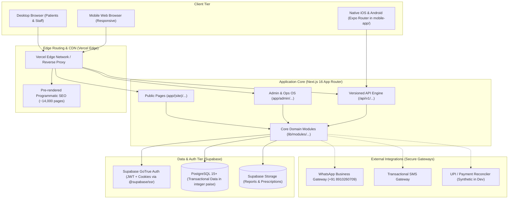

# CAPSIC CARE OS — Technical Architecture Specification

**Document Version:** 1.3.0  
**Status:** Unified Appointments & Reception Operations Active (Step 04)  
**Target Architecture:** Next.js 16 (App Router) + React 19 + TypeScript + Supabase (PostgreSQL & GoTrue Auth) + Tailwind CSS 4 + Expo Router  
**Environment Status:** Local Development Environment Isolated

---

## 1. System Architecture Overview

CAPSIC CARE OS follows a modular, unified architecture where a single Next.js application serves both customer-facing static/dynamic pages and the internal operational control plane, while exposing versioned RESTful APIs (`/api/v1`) for external integrations and native mobile applications.



---

## 2. Authentication & Authorization Architecture

### 2.1 Multi-Tier Client Bindings
1. **Server Client (`lib/supabase/server.ts`):** Utilizes `@supabase/ssr` `createServerClient` paired with Next.js 16 `cookies()` store. Runs inside Server Components, Server Actions, and Route Handlers with PKCE token refresh.
2. **Browser Client (`lib/supabase/client.ts`):** Lightweight client using `@supabase/ssr` `createBrowserClient` with public anon key for interactive client components.
3. **Admin Client (`lib/supabase/admin.ts`):** Strictly server-side client utilizing `SUPABASE_SERVICE_ROLE_KEY`. Bypasses RLS for system audit logging, administrative bootstrap, and webhook dispatching. **Never imported into client components.**

### 2.2 Scoped Role-Based Access Control (RBAC)
User permissions are evaluated with multi-branch and organization scoping:
- **Global Roles:** `super_admin` possesses cross-organizational privileges.
- **Branch Roles:** `branch_admin`, `receptionist`, `nurse`, `lab_staff`, `caller`, `field_staff`, `finance`, `doctor`, `careflow_manager` are scoped to specific branch UUIDs.
- **Patient Role:** `patient` role restricts record access strictly to the authenticated user's own profile (`profile_id = auth.uid()`).
- **Deny-by-Default:** Unassigned or inactive users receive automatic 403 Forbidden responses.

---

## 3. Shared API Foundation (`/api/v1/`)

All programmatic interactions adhere to strict REST conventions:

### Standard Response Envelopes
- **Success Envelope:**
  ```json
  {
    "success": true,
    "data": { ... },
    "error": null,
    "meta": { "page": 1, "limit": 20, "total": 100, "totalPages": 5 },
    "requestId": "req_1774070000000_abc123",
    "timestamp": "2026-11-19T12:00:00.000Z"
  }
  ```
- **Error Envelope:**
  ```json
  {
    "success": false,
    "data": null,
    "error": {
      "code": "VALIDATION_ERROR",
      "message": "Request validation failed",
      "details": [{ "field": "phone", "message": "Invalid phone format" }]
    },
    "requestId": "req_1774070000000_abc123",
    "timestamp": "2026-11-19T12:00:00.000Z"
  }
  ```

### Active Foundational Endpoints
- `GET /api/v1/health`: System health status, database connection test, latency, environment metadata.
- `GET /api/v1/me`: Profile details and role assignments of the active session (401 if unauthenticated).
- `GET /api/v1/branches`: Public directory of physical diagnostic hubs and centers.
- `GET /api/v1/doctors`: Paginated doctor registry with integer paise fee schedules and specialty filtering.

---

## 4. Mobile Application Integration Strategy

### Current Mobile State (`mobile-app/`)
- **Framework:** React Native `0.81.5`, Expo `~54.0.33`, Expo Router `~6.0.23`, NativeWind `^4.2.3`.
- **Existing Prototype:** Contained an experimental Firebase Auth prototype (`mobile-app/lib/firebase.ts`).

### Unification Roadmap
1. **Auth Migration:** Replace Firebase Auth with `@supabase/supabase-js` using `AsyncStorage` persistence in `mobile-app/lib/supabase.ts`.
2. **Unified Data Layer:** Configure `mobile-app/` to query the shared `/api/v1` Next.js route handlers (`/api/v1/doctors`, `/api/v1/branches`, `/api/v1/orders`).
3. **Shared Contracts:** Type definitions in `lib/data/types.ts` and `lib/modules/auth/types.ts` serve as the single source of truth across web and mobile builds.

---

## 5. Admin Operating System & Shell Architecture (Step 03)

### Application Shell & State Hierarchy
- **Context Layer (`BranchProvider`):** Provides selected operating branch context (`selectedBranchId`, `activeBranch`, `branches`) down to all admin pages, allowing instant switching between enterprise-wide global view and specific branch rosters.
- **Middleware Security Barrier (`middleware.ts`):** Enforces `@supabase/ssr` session cookie validation before serving any `/admin/:path*` page. Unauthenticated requests are immediately 307-redirected to `/login?redirect=...`. Whitelists `/admin/setup` for first-time owner bootstrap.
- **Top Bar (`AdminTopBar`):** Sticky command bar integrating branch switcher dropdown, global omnibox search foundation, real-time operational notifications, and user session menu.
- **Sidebar (`AdminSidebar`):** Collapsible desktop rail and mobile drawer exposing the 11 healthcare operational modules with status badges.
- **Decoupled Patient Intake:** Receptionist walk-in registration creates clinical records with auto-generated UHID (`CC-YYYY-XXXXX`) without mandating Supabase Auth credentials for patients.
- **Integer Paise Financial Engine:** All consultation fees, diagnostic prices, order subtotals, and invoice balances are handled strictly in integer paise (`₹500` stored as `50000`), completely eliminating floating-point rounding errors.

---

## 6. Unified Appointment Engine & Reception Operations (Step 04)

### Availability & Scheduling Core
- **Availability Service (`availability-service.ts`):** Dynamically computes real-time doctor slot availability based on weekly recurring schedules (`doctor_schedules`), room/chamber reservations (`chambers`), schedule exceptions (`schedule_exceptions`), and existing non-cancelled bookings.
- **Concurrency & Overlap Protection:** Enforced at the database transaction layer via PostgreSQL triggers preventing both doctor double-booking and chamber collision.
- **State Machine Lifecycle:** Appointments progress strictly through permitted state transitions (`scheduled` &rarr; `confirmed` &rarr; `checked_in` &rarr; `waiting` &rarr; `in_consultation` &rarr; `completed`), appending immutable audit records to `appointment_status_history`.
- **Reception Queue (`/admin/appointments/queue`):** Real-time priority run-sheet supporting token numbering, arrival timestamps, waiting duration metrics, and 1-click stage progression.
- **Printable Slip Generation:** Branded confirmation voucher optimized for thermal/A4 browser printing (`@media print`), explicitly distinguished from finalized tax invoices.


